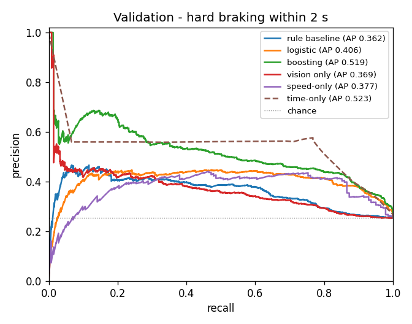
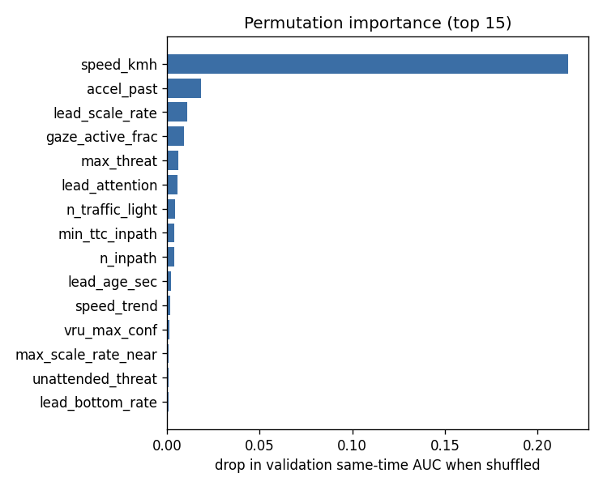
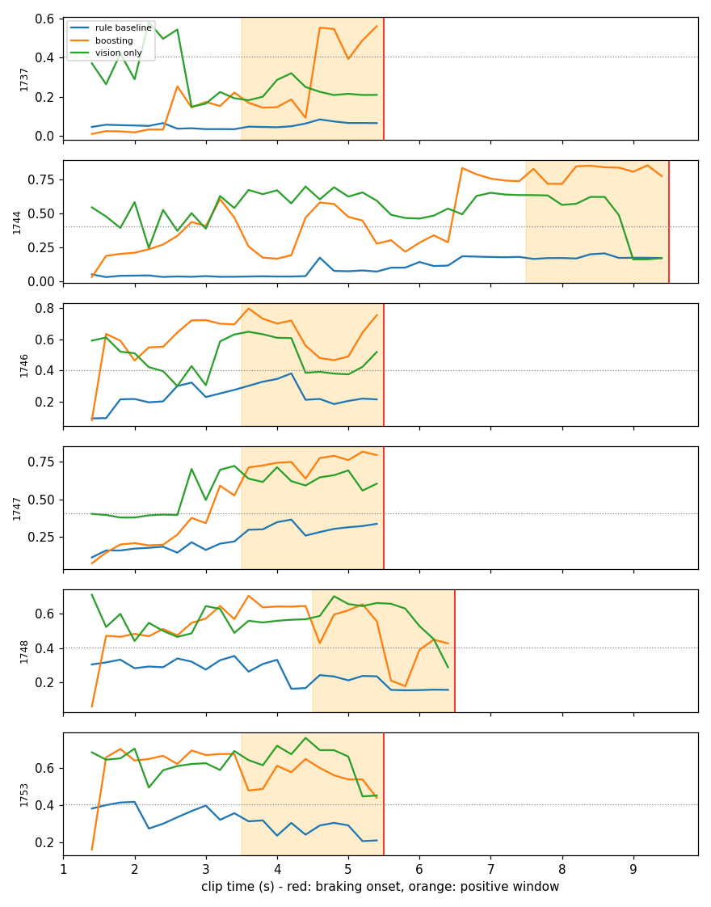

# Phase 5 - risk model, validation split

Task: for every 200 ms sample, predict a hard braking (GPS deceleration >= 2.0 m/s², speed before >= 1.5 m/s) within the next 2.0 s. In scope: samples after the 1.4 s warm-up and up to the onset; clips without a hard braking are negatives (`no_event_policy = negative`).
Training: 22923 samples / 799 clips. Validation: 2803 samples / 95 clips.
Selected model: **boosting** {'lr': 0.03, 'leaves': 31, 'l2': 1.0} (highest validation same-time AUC). Thresholds: best F1 on validation.

| model | same-time AUC | AP | ROC-AUC | F1 @thr | timely alarm | early alarm | miss | false-alarm clips | median lead (s) |
|---|---|---|---|---|---|---|---|---|---|
| rule baseline | 0.578 | 0.362 | 0.644 | 0.467 | 19.7 % | 69.0 % | 11.3 % | 83.3 % | 3.30 |
| logistic | 0.695 | 0.406 | 0.745 | 0.547 | 12.7 % | 87.3 % | 0.0 % | 83.3 % | 3.90 |
| boosting | 0.744 | 0.519 | 0.790 | 0.574 | 15.5 % | 84.5 % | 0.0 % | 79.2 % | 3.90 |
| vision only | 0.628 | 0.369 | 0.629 | 0.445 | 8.5 % | 87.3 % | 4.2 % | 100.0 % | 4.10 |
| speed-only | 0.730 | 0.377 | 0.723 | 0.556 | 14.1 % | 80.3 % | 5.6 % | 70.8 % | 4.10 |
| time-only | 0.500 | 0.523 | 0.812 | 0.659 | 73.2 % | 21.1 % | 5.6 % | 100.0 % | 1.90 |

Positive rate: 25.3 % (2803 samples; 71 hard-braking clips, 24 clips without).

95 % CIs, sequence-level bootstrap (1000 resamples):

- rule baseline, AP: [0.287, 0.443]
- rule baseline, same-time AUC: [0.478, 0.682]
- boosting, AP: [0.442, 0.598]
- boosting, same-time AUC: [0.664, 0.817]
- vision only, AP: [0.308, 0.432]
- vision only, same-time AUC: [0.557, 0.700]
- boosting - rule baseline, AP: [0.077, 0.238]
- boosting - rule baseline, same-time AUC: [0.056, 0.279]
- vision only - rule baseline, AP: [-0.062, 0.074]
- vision only - rule baseline, same-time AUC: [-0.053, 0.161]

**How to read this.** `time-only` sees nothing but the clip time; its AP shows how much the BDDA cut (braking onset at about 5.5 s in almost every clip) gives away. It scores 0.5 on the same-time AUC by construction. A model is only useful if it beats 0.5 there, i.e. if it ranks a sample before a hard braking above a sample of another clip at the same clip time.

`speed-only` ranks samples by GPS speed. A hard braking (>= 2 m/s² over ~1 s) is physically unlikely at very low speed, so speed alone separates many samples. The table below keeps only samples above a speed floor to show what each model adds beyond speed.

| speed >= (km/h) | samples | positive rate | rule baseline | logistic | boosting | vision only | speed-only |
|---|---|---|---|---|---|---|---|
| 0 | 2803 | 25.3 % | 0.578 | 0.695 | 0.744 | 0.628 | 0.730 |
| 15 | 2149 | 31.4 % | 0.572 | 0.640 | 0.700 | 0.614 | 0.681 |
| 25 | 1296 | 41.7 % | 0.533 | 0.461 | 0.614 | 0.588 | 0.495 |

(same-time AUC in each stratum)

## Ablation (validation)

| features | n | same-time AUC | AP |
|---|---|---|---|
| objects | 18 | 0.593 | 0.315 |
| objects + motion (vision) | 28 | 0.628 | 0.369 |
| vision + attention | 41 | 0.635 | 0.373 |
| GPS kinematics only | 4 | 0.741 | 0.552 |
| all - attention | 32 | 0.738 | 0.523 |
| all - GPS | 41 | 0.635 | 0.373 |
| all | 45 | 0.744 | 0.519 |

## Most useful features (permutation, validation same-time AUC)

- `speed_kmh`: +0.2166
- `accel_past`: +0.0181
- `lead_scale_rate`: +0.0110
- `gaze_active_frac`: +0.0093
- `max_threat`: +0.0059
- `lead_attention`: +0.0058
- `n_traffic_light`: +0.0041
- `min_ttc_inpath`: +0.0039
- `n_inpath`: +0.0037
- `lead_age_sec`: +0.0023
- `speed_trend`: +0.0017
- `vru_max_conf`: +0.0014

## Hyper-parameter selection (validation)

| kind | params | same-time AUC | AP |
|---|---|---|---|
| logistic | {'C_reg': 0.01} | 0.695 | 0.406 |
| logistic | {'C_reg': 0.1} | 0.689 | 0.406 |
| logistic | {'C_reg': 1.0} | 0.688 | 0.406 |
| boosting | {'lr': 0.03, 'leaves': 15, 'l2': 0.0} | 0.737 | 0.525 |
| boosting | {'lr': 0.03, 'leaves': 15, 'l2': 1.0} | 0.736 | 0.514 |
| boosting | {'lr': 0.03, 'leaves': 31, 'l2': 0.0} | 0.742 | 0.523 |
| boosting | {'lr': 0.03, 'leaves': 31, 'l2': 1.0} | 0.744 | 0.519 |
| boosting | {'lr': 0.1, 'leaves': 15, 'l2': 0.0} | 0.732 | 0.515 |
| boosting | {'lr': 0.1, 'leaves': 15, 'l2': 1.0} | 0.739 | 0.508 |
| boosting | {'lr': 0.1, 'leaves': 31, 'l2': 0.0} | 0.729 | 0.517 |
| boosting | {'lr': 0.1, 'leaves': 31, 'l2': 1.0} | 0.735 | 0.525 |

## Caveats

- BDDA clips are braking events cut at a fixed offset: base rates are not those of normal driving.
- Labels come from ~1 Hz phone GPS: onsets are known to about +/- 0.5 s.
- The gaze map is an in-lab attention reference (average of observers), not the recording driver's gaze; attention on an object is approximated from the map's centroid and spread.
- The ego path is a fixed image-space corridor (no lane detection); sizes are image proxies, not metres.
- Validation (95 clips) chose the model, its settings and the thresholds; only the test split is unbiased.
